<!-- ============ $ ./perfil.sh ============ -->
<p align="center">
  
</p>

<p align="center">
  <a href="https://www.linkedin.com/in/diegoprass/"></a>
  <a href="https://x.com/diegoprass"></a>
  <a href="https://www.pontosoft.com.br"></a>
  
  
</p>

<br/>

<!-- ============ 01. sobre_mim() ============ -->


[](https://git.io/typing-svg)

<div align="justify">

Sou **Full Stack Developer** no **[Grupo Insoft4](https://www.insoft4.com.br)**, onde ajudo a construir o **[Ponto Soft](https://www.pontosoft.com.br)**, plataforma `SaaS B2B` de controle de ponto e gestão de jornada.
No dia a dia trabalho com `Java`, `Grails`, `Ext JS`, `Oracle PL/SQL` e `JavaScript`, além de `Webflow`, `Figma` e integrações `RESTful` com CI/CD no GitLab.
São **mais de 15 anos em tecnologia**: comecei no suporte e infraestrutura, passei por Oracle, Java, QA e front-end e, antes de voltar ao desenvolvimento, liderei o **marketing digital** da empresa (SEO, Google Ads, GTM, Analytics, automação de e-mail).
Essa mistura me fez juntar código com **estratégia de produto e growth**. Hoje meu foco é levar **IA e LLMs** para dentro de produtos web, tema do meu **MBA em Tecnologia para Negócios: IA, Data Science e Big Data (PUCRS)**.

</div>

```diff
+ Construindo SaaS B2B com Java, Grails e Oracle
+ Levando IA e LLMs para dentro de produtos web
+ Unindo código, produto e growth (SEO, Ads, Analytics)
+ Experimentando agentes e LLMs locais (Ollama)
- Bugs em produção (estou trabalhando nisso)
```

<br clear="right"/>
<br/>

<!-- ============ 02. trajetoria() ============ -->

<p align="center">
  
</p>

<details>
<summary><b>🎓 formação e certificações</b></summary>
<br/>

- **MBA** em Tecnologia para Negócios: IA, Data Science e Big Data · PUCRS
- **Graduação** em Sistemas de Informação para Internet · FACCAT
- Inglês · IFSul
- Certificações: Scrum · OWASP Top 10 (Security misconfiguration, logging e monitoramento) · Design Thinking · React com JavaScript · Análise e Desenvolvimento de Sistemas

</details>

<br/>

<!-- ============ 03. tecnologias() ============ -->

<p align="center">
  
</p>

<p align="center">
  
  
  
  
  
  
  
</p>

<br/>

<!-- ============ 04. projetos() ============ -->

<p align="center">
  <a href="https://www.pontosoft.com.br"></a>
  <a href="https://github.com/diegoprass/skills"><picture><source media="(prefers-color-scheme: dark)" srcset="https://raw.githubusercontent.com/diegoprass/diegoprass/output/repo-1-dark.svg" /><source media="(prefers-color-scheme: light)" srcset="https://raw.githubusercontent.com/diegoprass/diegoprass/output/repo-1.svg" /></picture></a>
  <a href="https://github.com/diegoprass/Ia-coding-toolkit"><picture><source media="(prefers-color-scheme: dark)" srcset="https://raw.githubusercontent.com/diegoprass/diegoprass/output/repo-2-dark.svg" /><source media="(prefers-color-scheme: light)" srcset="https://raw.githubusercontent.com/diegoprass/diegoprass/output/repo-2.svg" /></picture></a>
  <a href="https://github.com/diegoprass/framework-5p"><picture><source media="(prefers-color-scheme: dark)" srcset="https://raw.githubusercontent.com/diegoprass/diegoprass/output/repo-3-dark.svg" /><source media="(prefers-color-scheme: light)" srcset="https://raw.githubusercontent.com/diegoprass/diegoprass/output/repo-3.svg" /></picture></a>
</p>

<br/>

<!-- ============ 05. estatisticas() ============ -->

<p align="center">
  <picture><source media="(prefers-color-scheme: dark)" srcset="https://raw.githubusercontent.com/diegoprass/diegoprass/output/stats-dark.svg" /><source media="(prefers-color-scheme: light)" srcset="https://raw.githubusercontent.com/diegoprass/diegoprass/output/stats.svg" /></picture>
  <picture><source media="(prefers-color-scheme: dark)" srcset="https://raw.githubusercontent.com/diegoprass/diegoprass/output/langs-dark.svg" /><source media="(prefers-color-scheme: light)" srcset="https://raw.githubusercontent.com/diegoprass/diegoprass/output/langs.svg" /></picture>
</p>

<p align="center">
  
</p>

<br/>

<!-- ============ 06. contribuicoes() — compilador de contribuições ============ -->

<picture>
  <source media="(prefers-color-scheme: dark)" srcset="https://raw.githubusercontent.com/diegoprass/diegoprass/output/code-contribution-graph-dark.svg" />
  <source media="(prefers-color-scheme: light)" srcset="https://raw.githubusercontent.com/diegoprass/diegoprass/output/code-contribution-graph.svg" />
  
</picture>

<!-- ============ exit ============ -->
<p align="center">
  
</p>
